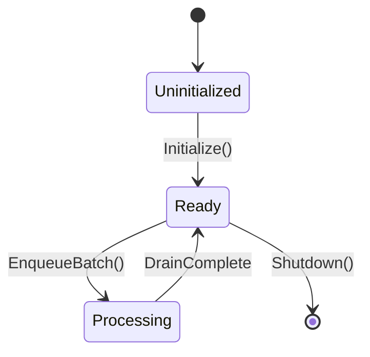

<!-- template/.agents/skills/extract-subsystem.md -->
# [SKILL] Extract Subsystem Specification (Tier 2)

## Purpose & Scope
This skill guides the deconstruction of a self-contained engine module, service, or subsystem from raw source code into a detailed, invariant-centric specification in `vault/subsystems/<name>.spec.md`.

---

## Execution Directives

1. **Locate the Boundary:** Identify where data enters (ingress) and exits (egress) this subsystem.
2. **Find the North Star Invariant:** Determine the foundational constraint the author defended at all costs (e.g., memory boundedness, lock-freedom, strict serializability).
3. **Map the State Machine:** Extract the lifecycle phases (initialization, execution, degradation, teardown).
4. **Identify the Battle Scars:** Search code comments for terms like `HACK`, `WORKAROUND`, `FIXME`, `NOTE:`, or platform-specific `#ifdef` branches to surface unadvertised production realities.

---

## Target Output Schema (`vault/subsystems/<name>.spec.md`)

```markdown
# [SUBSYSTEM SPEC] <Subsystem Name>

## 1. Executive Mental Model
- **Primary Responsibility:** <Single crisp sentence defining what this subsystem owns.>
- **Ownership & Lifetime:** <Who allocates it? Who frees it? Thread affinity?>
- **North Star Invariant:** <The fundamental rule this subsystem must never violate.>

## 2. Core Topology & State Machine
- **State Transition Graph:**

- **Key Data Structures:**
  - `<Struct/Class Name>`: <Memory layout, cache-alignment rationale, packing tricks, ownership model.>

## 3. Data Pathways & Concurrency
- **Hot Path (Execution Critical):**
  - *Ingress:* <How data enters without blocking.>
  - *Processing:* <Vectorized? Batch-processed? Lock-free ring buffer?>
  - *Egress:* <How results are published or handed off.>
- **Cold Path (Setup / Reconfiguration):**
  - <Configuration updates, re-allocations, metrics publication.>
- **Memory Management Strategy:** <Arenas, custom pools, GC roots, or zero-copy buffer views.>

## 4. Edge Cases & Defensive Architecture
- **Failure Modes:** <How it behaves under memory exhaustion, buffer saturation, or network disconnects.>
- **Production Battle Scars:** <Workarounds found in code with citations to source comments or commit hashes.>

## 5. Source Provenance
- **Primary Files:** `<path/to/source.cpp:lines>`, `<path/to/header.h:lines>`
- **Associated Commits:** `<commit-sha> (Descriptive commit message summary)`
```